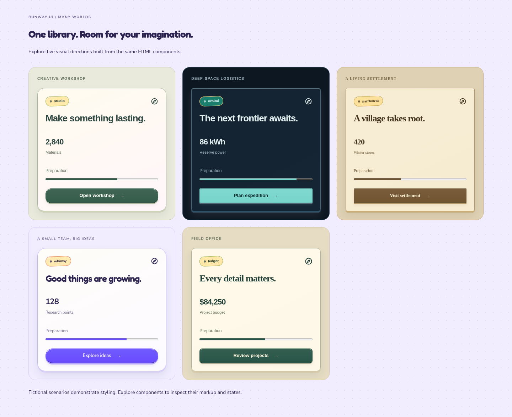

# Runway UI

[](https://github.com/kahwee/runway-ui/actions/workflows/package.yml) [](LICENSE)

**Modern HTML/CSS interfaces for management and simulation games.**

Resource HUDs, production ledgers, economy charts, equipment grids, objectives and native dialogs. The vanilla core is framework-independent, themeable, and has zero runtime dependencies. An [optional React 19 entry](docs/REACT.md) composes Base UI primitives. Optional ES modules add keyboard navigation, controller input and virtual inventories.

**MIT licensed. Free for personal and commercial projects, including closed-source games.** Keep the license notice in redistributed copies. No attribution in your interface is required. See [LICENSE](LICENSE).

[](https://kahwee.github.io/runway-ui/storybook/?path=/story/start-here-many-worlds--gallery)

## Choose your world

The same components can serve a workshop, space station, settlement or field office.
[Explore the five-theme gallery](https://kahwee.github.io/runway-ui/storybook/?path=/story/start-here-many-worlds--gallery) to compare their character side by side.

| Explore | What it demonstrates |
| --- | --- |
| [Paper studio](https://kahwee.github.io/runway-ui/examples/studio.html) | Warm surfaces, illustrated season cover and native controls |
| [Simulation Observatory](https://kahwee.github.io/runway-ui/examples/observatory.html) | Metrics, history, resource inspection and decisions |
| [Colony](https://kahwee.github.io/runway-ui/examples/colony.html) | Production and a large virtual inventory |
| [Isolated components](https://kahwee.github.io/runway-ui/storybook/?path=/story/isolation-components--fields) | Minimal imports verified without the full stylesheet |
| [Dependency recipes](docs/DEPENDENCIES.md) | Copyable markup and exact CSS requirements |
| [Optional React](docs/REACT.md) | React 19 integration using Base UI |

## Find your way

Start with the installation below, then choose the resource for your task:

| Task                                       | Resource                                                                                                |
| ------------------------------------------ | ------------------------------------------------------------------------------------------------------- |
| Learn the library and choose a guide       | [Documentation map](docs/README.md)                                                                     |
| Find classes, defaults and copyable markup | [Component reference](https://kahwee.github.io/runway-ui/docs/#reference)                               |
| Try component states and theme controls    | [Storybook](https://kahwee.github.io/runway-ui/storybook/)                                              |
| See components assembled into a screen     | [Workshop](https://kahwee.github.io/runway-ui/) and [Simulation Observatory](examples/observatory.html) |
| Change the library itself                  | [Contributing and repository layout](CONTRIBUTING.md)                                                   |

The docs explain usage and contracts. Storybook is the interactive component explorer. Examples demonstrate compositions with synthetic data; they do not run a simulation.

## Start with one stylesheet

Download this repository and link the self-contained bundle:

```html
<link rel="stylesheet" href="./runway-ui/dist/runway-ui.css">

<section class="rw-ui rw-panel" data-theme="orbital" aria-labelledby="mission">
  <h2 id="mission">Prepare the expedition</h2>
  <button class="rw-button" data-variant="primary">Launch</button>
</section>
```

Or install directly from GitHub:

```sh
bun add github:kahwee/runway-ui
```

```js
import "runway-ui/bundle.css";
// Optional modular entry: import 'runway-ui';
import { bindDialog } from "runway-ui/dialog";
```

This project is available on GitHub; **it has not been published to the npm registry**. GitHub installation is shown intentionally. The committed CSS bundle is ready to use without a build step. Development uses Bun 1.4.4. Node 22.18+ (or 24.11+) remains available for third-party tools such as Storybook; consumers need neither runtime for the CSS bundle.

## Explore locally

```sh
python3 -m http.server 4320 --bind 127.0.0.1
```

Open **`http://127.0.0.1:4320/docs/charts.html`** for the CSS chart lab, or `http://127.0.0.1:4320/docs/` for searchable component options. The root page is the component workshop. Other examples:
- [Illustrated workspace navigation](examples/view-tabs.html): six generic destinations with original vector miniatures.
- `examples/colony.html`: production, reserve history and a searchable 10,000-item synthetic inventory.
- `examples/drop-in.html`: opt-in styling for existing native form controls.

The examples target desktop windows at least 1100 × 640. The CSS library itself does not impose a viewport gate.

## What's included

| Module             | Components                                                                                                                                             |
| ------------------ | ------------------------------------------------------------------------------------------------------------------------------------------------------ |
| Foundations        | Theme tokens, cascade layers, surfaces, typography, focus and state colors                                                                             |
| Primitives         | Buttons, panels, badges, inputs, disclosures, native dialog styling                                                                                    |
| Game patterns      | Resource HUD, equipment slots, objectives, choices, action dock                                                                                        |
| CSS charts         | Columns, stacked bars, diverging bars, six-point areas, percentage-based HTML-table bars; [API and scale rules](docs/CHARTS.md)                        |
| Simulation         | Subgrid production ledger and container-aware panels                                                                                                   |
| Themes             | Warm Studio, dark Orbital, Parchment, playful Whimsy and Ledger; identical markup                                                                              |
| Optional behaviors | Native dialog dismissal policy, roving keyboard focus, standard controller adapter, fixed-height virtual inventory, range outputs and windowed history |

All component classes use `rw-`; the root `rw-ui` supplies inherited tokens without a global reset. Application styles can override the cascade layers. This is a CSS namespace, not Shadow DOM isolation.

## Easy adoption

1. **Components:** add the stylesheet, a `rw-ui` root and documented component classes.
2. **Existing forms:** add `rw-native` to the root (included in the full bundle; `runway-ui/native.css` is a standalone form entry). Native submission and control semantics stay intact.
3. **Interactions:** import only the optional modules you need; retain their handles and call `destroy()` on unmount.

Runway UI is not an API-compatible replacement for another UI framework. Existing custom widgets may need markup changes. The CSS core does not run a simulation, store saves or render a world.

## Modern browser features

- **Subgrid** aligns production rows with their parent's shared columns.
- **Container queries** adapt panels to their allocated space.
- **Native HTML dialog** supplies top-layer modality, focus and background inertness.
- **Cascade layers, logical properties, custom properties, color-mix() and :has()** provide composition and theming.
- **@starting-style and discrete transitions** enhance dialog motion when supported.
- **Reduced motion and forced colors** adjust animation and state indicators.

Targets current desktop Chromium, Firefox and Safari with subgrid and container-query support. The optional dialog helper requires native `showModal()` and `close()`. Newer dismissal APIs are optional; the helper provides local fallbacks while keeping focus and inertness native. Dialog CSS uses `:open`. See [dialog requirements](docs/DIALOG.md). Desktop Chromium checks are documented in [STATUS.md](docs/STATUS.md); broader browser and assistive-technology validation remains work in progress.

## Documentation

- [Component markup](docs/COMPONENTS.md), [theming](docs/THEMING.md) and [native fields](docs/FIELDS.md)
- [CSS charts](docs/CHARTS.md), [history instruments and windowed time series](docs/INSTRUMENTS.md)
- [Options and behavior API](docs/API.md), [compatibility contract](docs/STABILITY.md) and [changelog](docs/CHANGELOG.md)
- [Keyboard, controller and inventory contracts](docs/INTERACTIONS.md)
- [Status and current limitations](docs/STATUS.md)
- [Contributing](CONTRIBUTING.md)
- [MIT license](LICENSE)

## Development

```sh
bun install --frozen-lockfile
bun run check
bun run check-boundaries
bun run test-boundaries
bun run test-dialog
bun run build
bun pm pack --dry-run
```

The library has no third-party runtime dependencies or remote font/asset requests. Development installation downloads tooling and icon/font inputs; Storybook bundles its local font dependencies. The CSS bundle is generated from `index.css` and `styles/`; edit source modules and rebuild the bundle. Type declarations accompany every optional behavior.

Early-stage API: improvements should keep markup predictable, effects modest and boundaries explicit. Suggestions and small, focused contributions are welcome.

## Documentation development and hosting

See the [Storybook guide](docs/STORYBOOK.md). Run `bun install --frozen-lockfile`, then `bun run storybook` for the HTML component explorer. `bun run build-site` creates the public allowlisted `.site/` folder with Storybook under `/storybook/`. GitHub Actions deploys it to GitHub Pages on pushes to `main`. npm package publication is separate.

Native dialog stories use HTML invoker commands (`commandfor`, `command="show-modal"`) and `form method="dialog"`. The optional dialog helper adds dynamic dismissal policy on browsers with native `requestClose()` and `closedBy`; it is not a polyfill. Native disclosures and form controls need no event handlers.

Dialog styling is opt-in with `rw-dialog`, structured `rw-dialog__header`, `__body` and `__footer` classes, plus compact/wide/danger modifiers. See the [dialog class guide](docs/DIALOG.md) and [dialog playground](https://kahwee.github.io/runway-ui/storybook/?path=/story/foundations-dialog--playground).

For restrained surfaces and controls, see [Quiet appearance](docs/QUIET.md).

### Paper studio

See [the paper workspace example](examples/studio.html) for reusable warm-paper HUD surfaces, an illustrated season cover, native selects and pace buttons. Import the full bundle or `runway-ui/studio.css` alongside the base tokens and workspace primitives. The Storybook **Game patterns / Paper studio** playground exposes season, rank, artwork and pace controls.

Behavior declarations are generated from strictly checked JavaScript JSDoc, with
consumer type fixtures for every optional package entry. See
[generated types and behavior ownership](docs/TYPES.md) for the workflow.
